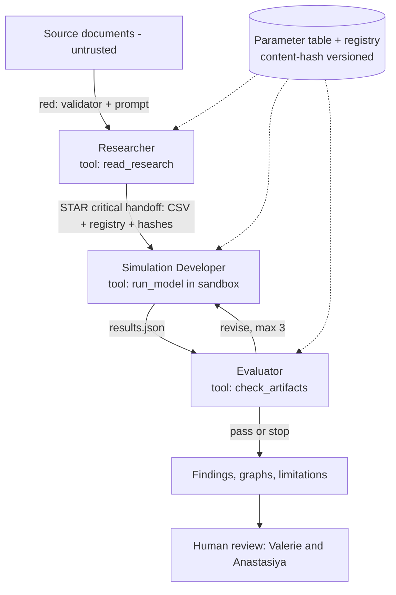

# Architecture notes: enforced by, shared state, critical handoff (DRAFT)

Drafted 2026-10-22 by Valerie with Claude Code.  These notes go with the architecture diagram (`lynxboard.png`), which needs a second version.  Draw version 2 on paper together first (LaNice's rule), then commit the picture and this file in the same pull request as the code it describes.

## In plain words

Project Resurrection is a research tool with one question:  how do food and usable habitat change whether a small Iberian lynx population survives?  Three AI roles prepare and check the work.  The **Researcher** builds a sourced parameter table.  The **Simulation Developer** writes and runs the model code.  The **Evaluator** checks the code and the results.  Ordinary code, the **harness**, passes the files between them, counts the rounds, and stops after round 3.

The simulated lynx are individual animals inside ordinary Python code.  They are not AI agents, and the AI roles do not compare predator and prey numbers themselves.  Rabbits are a food amount (rabbits per hectare) that stays fixed in each run; a changing rabbit population model is a stretch goal if time allows.  Two coding assistants (Claude Code and Codex) help the two teammates write this repository; they are not part of the running system.

Implementation status checked against `develop` on October 29, 2026: file contracts, validators, numerical simulation, the offline harness, hand-back helpers, role runner, and opt-in live adapter exist. The default three-role rehearsal is scripted; the live workflow has separately saved integration examples described in `docs/live-workflow.md`. The Developer invokes a fixed simulator, not generated code. Integration evidence does not establish scientific validity or better performance than one agent.

## Who owns what

- Researcher and its files (the parameter table and the source registry):  Valerie.
- Simulation Developer:  Anastasiya.
- Evaluator and the history test:  Valerie.
- Parameter validator and handoff examples:  Anastasiya.
- Harness:  both, built together.

## The three handoffs

Each handoff carries a task, the context it needs, and the confidence of what it carries.  The field lists are in `docs/agent-handoffs.md`.

- **Researcher to Developer** (`input.json`).  Task:  build the model and run the experiment grid.  Context:  the parameter table and the source registry, named by path and by content hash.  Confidence:  free text today; the planned fields are in `docs/handoff-decisions.md`.
- **Developer to Evaluator** (`results.json`).  Task:  check this run.  Context:  the run ID, seed, configuration, and the same hashes.  Confidence:  the assumptions that the run lists in `results.json`, together with the research evidence behind the parameters (confidence fields planned).  `data_kind` says whether the file is a hand-written sample or a simulation output; it is provenance, not confidence.
- **Evaluator to Developer** (`evaluation.json`).  Task:  pass, revise, or stop.  Context:  each issue as a code, a message, and a requested change, with the round number.  `historical_validation` is a field of `evaluation.json`, and it stays `not_assessed` until the history test has run.

## The shared state and who writes it

The one shared state is the parameter table plus the source registry.  The Researcher is the only writer.  The harness validates the files and makes a read-only snapshot with content hashes for each run.  The Developer and the Evaluator read the snapshot and never edit it.  This split was proposed by Anastasiya on 2026-10-22 and is to be confirmed when the two of us pair.

## What the diagram v2 must show

- Red arrows for text we do not trust:  (1) source documents into the Researcher; (2) any agent output into the harness; (3) text inside the `evidence_or_assumption` column read by the Developer or the Evaluator.  Beside each arrow, say what catches it.
- A star on the one critical handoff:  the parameter table and source registry (with content hashes) from the Researcher to the Simulation Developer.  If it is dropped or stale, every later result is wrong.
- A box for the single shared state:  "Parameter table and source registry, versioned by content hash; the Researcher writes, the Developer and Evaluator read."
- Under each agent, its one tool:  `read_research`, `run_model` (sandboxed), `check_artifacts`.
- A human box after the output:  Valerie and Anastasiya review findings before anyone interprets them.
- A legend with two tags:  CODE (the harness enforces it) and PROMPT (the model is asked).
- At each handoff, the failure response:  hand back, escalate to a person, or fail loudly (stop and report).

## Enforced by

| Rule | Enforced by |
|---|---|
| Handoff files match the schema | CODE (validator) |
| Content hashes match across handoffs | CODE (`check_handoff_hashes`, pull request 9; it compares the hash fields only) |
| Result run ID, seed, and configuration match input | CODE (`validators/results_checks.check_identity`); `check_handoff_hashes` compares hashes only. Strict callback run/round checks are a separate harness fix. |
| Parameter files unchanged since the input | CODE (`check_files_current`, pull request 9) |
| Maximum 3 revision rounds, then stop and report | CODE (harness) |
| Generated code runs under the execution rules | PLAN (`docs/execution-sandbox.md`); the current Developer runs only the fixed simulator, so this is not evidence of generated-code isolation |
| Source text is evidence, never instructions | PROMPT plus CODE (unknown source keys rejected) |
| Do not invent citations, values, or results | PROMPT, checked by the Evaluator |
| Historical validation stays "not assessed" until the test runs | CODE (schema constant) |

## Draft diagram source

## Open decisions

- Who writes the shared state:  proposed above (the Researcher writes; the harness snapshots); to confirm.
- Who computes the content hashes:  decided on 2026-10-22 by both owners.  The harness computes them from the actual input files, and the agents carry them unchanged.
