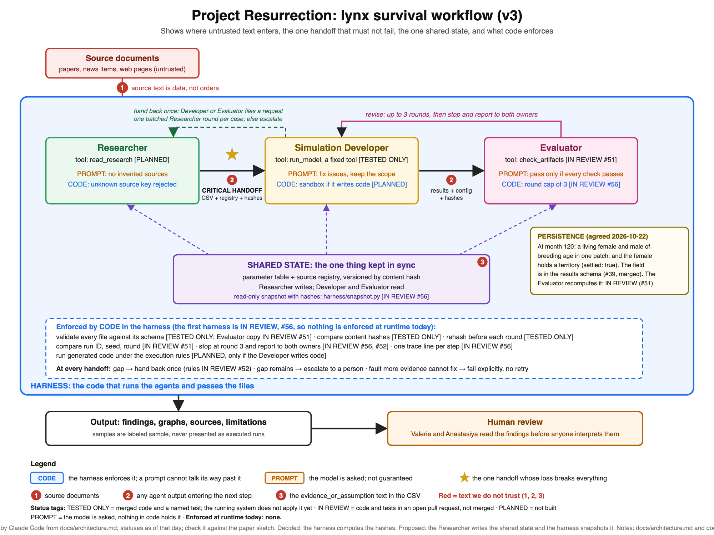
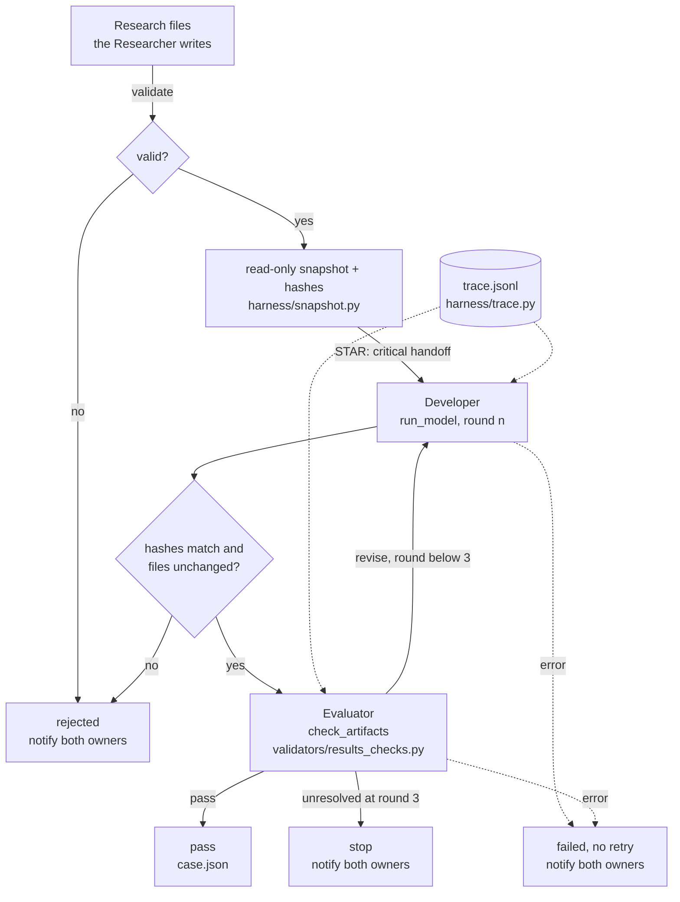

# Offline harness skeleton (PROPOSED)

Written 2026-10-24 by Valerie with Claude Code, for the pairing session on 2026-10-25.  The code is `harness/run_case.py`, `harness/snapshot.py`, and `harness/trace.py`; its tests are `tests/test_harness.py`.  Status:  **TESTED ONLY**.  The skeleton runs end to end offline, but it calls no model, so no agent runs through it yet.  Nothing here is agreed until Anastasiya says yes.

## The diagram (version 3)



Source: `docs/diagrams/architecture-v3.svg`.  Composed on 2026-10-24 by Claude Code from `docs/architecture.md` and the version 2 source.  Valerie's paper sketch has not been compared with it yet; if the sketch differs, the sketch wins and this file changes.  Statuses were checked on 2026-10-26: evaluator checks and hand-back rules are on `develop`; the harness integration is in open PR #74.  Refresh the labels when those branch states change.

## What it does

One case, from the research files to `pass`, `stop`, `rejected`, or `failed`:

1. The harness validates the two research files.  A failure rejects the case before anything runs.
2. The harness copies the files into a read-only snapshot (mode 444) and computes their hashes.
3. The Developer runs the fixed `run_model` tool (the simulator) on an input built from the snapshot.
4. The harness compares the hashes and checks that the files are unchanged.
5. The Evaluator runs the code checks (`check_artifacts`, `validators/results_checks.py`).
6. `pass` ends the case.  `revise` sends the issues back to the Developer, up to revision round 3; then the case stops and names both owners.
7. Every step is one line of `trace.jsonl`.  The case ends with `case.json`.

The top-level `notify` field lists owners only for a non-passing case.  `clarification` is `null` unless the hand-back case itself has stopped; a normal pass does not create an open clarification report.

A Developer or Evaluator that raises an error fails the case with the reason and is never retried.  A changed research file or a hash mismatch rejects the case with no retry.  Those rules follow `docs/handoff-decisions.md`.

## How the diagram maps to the code



## What each test guards

| Rule | Test |
|---|---|
| A clean case passes in round 0 and writes every file | `test_a_clean_case_passes_in_round_0_and_writes_every_file` |
| The snapshot is read-only and matches the source; the run is built from it | `test_the_snapshot_is_read_only...`, `test_the_run_is_built_from_the_snapshot...` |
| Issues go back to the Developer; a fixed result passes | `test_a_wrong_result_goes_back...` |
| Stop after round 3, never a fifth attempt, and the harness caps the rounds itself | `test_the_case_stops_after_round_3...`, `test_the_harness_caps_the_rounds...` |
| A changed research file or a hash mismatch rejects the case | `test_a_changed_research_file...`, `test_results_with_other_hashes...` |
| A bad research table stops the case before anything runs | `test_a_bad_research_table...` |
| An error in a role fails the case, no retry | `test_a_developer_that_raises...`, `test_an_evaluator_that_raises...` |
| The trace has one numbered line per step, holds no key, and shows what it cut | `test_the_trace_...` tests |
| No model, no network, no subprocess in the harness | `test_the_harness_calls_no_model_and_opens_no_network` |
| Nothing is overwritten | `test_an_existing_output_folder_is_never_overwritten` |

## How to run it

```bash
python -m harness --preview --seed 7 --months 36 --output runs/case-1
```

Use a new folder each time.  The exit code is 0 for `pass`, 1 for `stop`, `rejected`, or `failed`, and 2 when the harness cannot start.

## Not built yet

- Any role that calls a model (the Researcher, a Developer that chooses settings, an Evaluator that explains).  Each replaces `developer` or `evaluator` in `run_case` without changing the loop.
- The hand-back path inside the loop (`harness/handback.py` holds the rules; nothing calls them yet).
- The sandbox for generated code, which is needed only if the Developer writes code (`docs/execution-sandbox.md`).
- The history test and the grid inside the loop.

The fixed `run_model` tool was agreed on 2026-10-25, so it is no longer an open decision.

## Remaining decisions for the pairing session

- Where the trace lives (a `runs/<run_id>/` folder, as here, or a separate log folder) and how long it is kept.
